## Workflow Diagram
- This diagram illustrates the workflow of the primary functions making up the docker-transcodeautomation container. It is not necessary to read and understand it for any reason other than curiosity.

***

## Execution Flow

- This page follows the runtime from `build/Invoke-TranscodeAutomation.ps1` through the functions and scripts it invokes. These sections are intended for tracing execution flows.

## Startup And Scheduler

```mermaid
flowchart TD
  docker["Dockerfile: launch PowerShell entrypoint"] --> entry["build/Invoke-TranscodeAutomation.ps1"]
  entry --> ps7{"PowerShell major version is 7?"}
  ps7 -- no --> noop["No else branch; script exits"]
  ps7 -- yes --> init["Start transcript; clean old logs; set paths; create directories; import PSSQLite"]
  init --> db{"Database state"}
  db -- "Neither database exists" --> setup["functions/Invoke-DBSetup.ps1"]
  db -- "Current exists; legacy absent" --> migrate["scripts/Update-Database.ps1"]
  db -- "Legacy database exists" --> rename["Rename legacy database to media.db"]
  setup --> migrate
  rename --> migrate
  migrate --> drive["Create transcoding PSDrive"]
  drive --> vars{"Required environment variables present?"}
  vars -- no --> envhang["Infinite sleep; processing does not start"]
  vars -- yes --> load["Dot-source all build/functions/*.ps1"]
  load --> defaults["Set library arrays and defaults for window, MINAGE, PROCDELAY"]
  defaults --> mode{"UPDATEMETADATA is true?"}
  mode -- yes --> metadata["scripts/Update-Metadata.ps1"]
  metadata --> metawait["One metadata pass, then infinite sleep"]
  mode -- no --> scheduler["Perpetual scheduler loop"]
  scheduler --> time["functions/Invoke-TimeCompare.ps1"]
  time --> inwindow{"Inside processing window?"}
  inwindow -- no --> offwindow["Log that processing is outside its window"]
  offwindow --> sleep["Sleep PROCDELAY seconds"]
  inwindow -- yes --> recover["functions/Move-FileToMediaFolder.ps1: retry pending processed-file moves"]
  recover --> manage["functions/Invoke-MediaManagement.ps1"]
  manage --> processed{"Initial Update-Processed delay elapsed?"}
  processed -- no --> skipprocessed["Log remaining delay"]
  processed -- yes --> updateprocessed["scripts/Update-Processed.ps1: if not run in 7 days, reconcile database rows and record run"]
  skipprocessed --> backup["functions/backup-mediadb.ps1: weekly backup; delete backups older than 30 days"]
  updateprocessed --> backup
  backup --> stats["functions/Update-Statistics.ps1: daily history when due; refresh live stats"]
  stats --> sleep
  sleep --> scheduler

  click docker "#startup-and-scheduler" "The image installs PowerShell and FFmpeg, copies build/, and starts the entrypoint."
  click entry "#startup-and-scheduler" "The main controller for initialization, metadata mode, and the long-running scheduler."
  click ps7 "#startup-and-scheduler" "Only PowerShell 7 runs the body; other versions fall through without an else path."
  click noop "#startup-and-scheduler" "Terminal path: the script ends without initialization."
  click init "#startup-and-scheduler" "Creates runtime folders, sets FFTools locations, starts logging, and imports SQLite commands."
  click db "#startup-and-scheduler" "Selects first-run setup, current database, or legacy database migration."
  click setup "#startup-and-scheduler" "Creates media, statistics, index, description, log tables, and views."
  click migrate "#startup-and-scheduler" "Adds missing tables, columns, and descriptions for newer versions."
  click rename "#startup-and-scheduler" "Renames the legacy SQLite file to the current media.db path."
  click drive "#startup-and-scheduler" "Exposes transcoding-volume free space through a PowerShell drive."
  click vars "#startup-and-scheduler" "Requires BACKUPPROCESSED, BACKUPRETENTION, MEDIAMOVIEFOLDERS, and MEDIASHOWFOLDERS."
  click envhang "#startup-and-scheduler" "Terminal wait: missing required variables leave the container sleeping indefinitely."
  click load "#startup-and-scheduler" "Loads every function script into the entrypoint's session."
  click defaults "#startup-and-scheduler" "Splits configured libraries and supplies default timing and age values."
  click mode "#startup-and-scheduler" "Chooses metadata-only migration or normal transcode scheduling."
  click metadata "#startup-and-scheduler" "Remuxes eligible existing media to apply immutable comment metadata."
  click metawait "#startup-and-scheduler" "Terminal wait after the one-time metadata script returns."
  click scheduler "#startup-and-scheduler" "Repeats window check, processing, maintenance, and sleep forever."
  click time "#startup-and-scheduler" "Compares the current time with STARTTIMEUTC and ENDTIMEUTC."
  click inwindow "#startup-and-scheduler" "Routes each scheduler pass to processing or an off-window sleep."
  click offwindow "#startup-and-scheduler" "No media work runs during this pass; the scheduler still sleeps and retries."
  click recover "#startup-and-scheduler" "Processes files already in the processed directory before new scans."
  click manage "#startup-and-scheduler" "Runs show scanning, movie scanning, and recovery-file cleanup."
  click processed "#startup-and-scheduler" "The first run is delayed; the script also enforces its own seven-day guard."
  click skipprocessed "#startup-and-scheduler" "Maintenance continues while the initial processed-date delay counts down."
  click updateprocessed "#startup-and-scheduler" "Reconciles database comments and file-existence state for movies and shows."
  click backup "#startup-and-scheduler" "Creates at most one recent backup per week and prunes old backups."
  click stats "#startup-and-scheduler" "Updates historical statistics when due and live statistics each eligible pass."
  click sleep "#startup-and-scheduler" "Waits PROCDELAY seconds, then returns to the scheduler window check."
```

## File Processing

```mermaid
flowchart TD
  manage["Invoke-MediaManagement"] --> showgate{"FFTools source and target roots clear?"}
  showgate -- yes --> shows["Invoke-MEDIAShowsToProcess.ps1"]
  showgate -- no --> showblocked["Log blocked show pass"]
  shows --> moviegate{"Roots clear for movie pass?"}
  showblocked --> moviegate
  moviegate -- yes --> movies["Invoke-MEDIAMoviesToProcess.ps1"]
  moviegate -- no --> movieblocked["Log blocked movie pass"]
  movies --> cleanup["Delete recover files older than BACKUPRETENTION"]
  movieblocked --> cleanup
  shows --> scan
  movies --> scan
  scan["For each library and candidate: check SQLite; compare disk paths with indexed paths; ffprobe tags; check roots, 3x free space, and MINAGE"]
  scan --> integrity{"SQLite integrity check passes?"}
  integrity -- no --> abort["Abort this scan; outer scheduler continues"]
  integrity -- yes --> eligible{"Candidate passes root, age, and space gates?"}
  eligible -- no --> next["Skip candidate or log reason; continue candidate loop"]
  eligible -- yes --> tagged{"Comment already starts dta-*?"}
  tagged -- yes --> dbonly["Update database only; dta-remuxed gets a fresh index and metadata remux"]
  tagged -- no --> index["functions/Update-LastIndex.ps1: increment ImmutableIndex"]
  index --> copy["Copy tagged file to FFTools source; insert or update Movies/Shows row"]
  copy --> kind{"Movie or show?"}
  kind -- movie --> pm["functions/Invoke-ProcessMovie.ps1"]
  kind -- show --> ps["functions/Invoke-ProcessShow.ps1"]
  pm --> startm["functions/Start-TranscodeMovies.ps1"]
  ps --> starts["functions/Start-TranscodeShows.ps1"]
  startm --> transcode
  starts --> transcode
  transcode["For each .mkv/.mp4: functions/Skip-Analysis.ps1"] --> skipped{"Skip criteria matched?"}
  skipped -- yes --> marker["Write skip marker and database reason"]
  skipped -- no --> custom{"Custom movie/show options script exists?"}
  custom -- yes --> customrun["Run custom options script"]
  custom -- no --> params["functions/Build-TranscodeParams.ps1: probe source and build FFmpeg/HDR options"]
  params --> ffmpeg["Run FFmpeg transcode"]
  marker --> validate
  customrun --> validate
  ffmpeg --> validate["Compare source/target counts and output sizes"]
  validate --> output{"Target output is nonzero?"}
  output -- no --> stranded["Log failure; root files may block later scans"]
  output -- yes --> larger{"Output larger than source?"}
  larger -- yes --> remux["Discard output; remux source with comment; remove source"]
  larger -- no --> keep{"BACKUPPROCESSED is true?"}
  keep -- yes --> recoverfile["Move source to recover"]
  keep -- no --> delete["Delete source"]
  remux --> processed["Move nonzero output to processed"]
  recoverfile --> processed
  delete --> processed
  processed --> moveback["functions/Move-FileToMediaFolder.ps1: match comment, update database, replace destination"]
  moveback --> next
  dbonly --> next
  next --> scan
  cleanup --> done["Return to scheduler maintenance"]

  click manage "#file-processing" "Runs shows first, movies second, then expires old recover files."
  click showgate "#file-processing" "Transcoding directories must be clear before a scan starts."
  click shows "#file-processing" "Scans configured show libraries and routes eligible files to the show handler."
  click showblocked "#file-processing" "Existing source or target files prevent the show scanner from proceeding."
  click moviegate "#file-processing" "Checks the same root-directory safety condition before movie scanning."
  click movies "#file-processing" "Scans configured movie libraries and routes eligible files to the movie handler."
  click movieblocked "#file-processing" "Existing source or target files prevent the movie scanner from proceeding."
  click cleanup "#file-processing" "Removes recovery files past the configured retention period."
  click scan "#file-processing" "Each scanner compares library contents to database paths and evaluates candidate metadata and eligibility."
  click integrity "#file-processing" "A failed SQLite integrity check stops that scanner or move operation."
  click abort "#file-processing" "This operation ends, but the main scheduler still reaches maintenance and its next cycle."
  click eligible "#file-processing" "Requires empty FFTools roots, sufficient free space, and file age at least MINAGE."
  click next "#file-processing" "The scanner proceeds to the next candidate or returns after its current batch."
  click tagged "#file-processing" "Existing dta-* comments are reconciled without normal re-encoding."
  click dbonly "#file-processing" "Updates the database; dta-remuxed is rewritten with a new immutable index."
  click index "#file-processing" "Returns a new dta-########## comment and persists the incremented index."
  click copy "#file-processing" "Stages a tagged copy in the source directory and associates it with its media row."
  click kind "#file-processing" "Selects the matching movie or show processing function."
  click pm "#file-processing" "Handles movie transcode setup, output validation, and source cleanup."
  click ps "#file-processing" "Handles show transcode setup, output validation, and source cleanup."
  click startm "#file-processing" "Loops over source video files and applies movie skip/custom/transcode behavior."
  click starts "#file-processing" "Loops over source video files and applies show skip/custom/transcode behavior."
  click transcode "#file-processing" "Analyzes each source file; skipped media is remuxed later rather than re-encoded."
  click skipped "#file-processing" "Skip rules include configured codecs, bitrate, duration, HDR, and Dolby Vision."
  click marker "#file-processing" "Records the skip reason so the handler can remux the source into the target."
  click custom "#file-processing" "User-provided options scripts override the built-in argument builder."
  click customrun "#file-processing" "Runs the external custom options script for the selected media type."
  click params "#file-processing" "Builds FFmpeg arguments, including detected color and HDR metadata."
  click ffmpeg "#file-processing" "Encodes using the generated or custom FFmpeg arguments."
  click validate "#file-processing" "Checks paired source and target files, handles skip remux, and stages nonzero outputs."
  click output "#file-processing" "Zero-byte or missing targets are not accepted as successful transcodes."
  click stranded "#file-processing" "Root-level leftovers can block subsequent scanners until manually resolved."
  click larger "#file-processing" "Larger encodes are discarded; the original is remuxed to update its comment."
  click remux "#file-processing" "Preserves source streams while applying metadata, then removes the staged source."
  click keep "#file-processing" "Controls whether the original source is retained in recover or deleted."
  click recoverfile "#file-processing" "Keeps the original under FFTools target/recover."
  click delete "#file-processing" "Deletes the original after a successful non-larger output."
  click processed "#file-processing" "Moves valid target files into the processed staging folder."
  click moveback "#file-processing" "Uses the embedded comment to find the original destination and update its database row."
  click done "#file-processing" "Control returns to the main scheduler's maintenance steps."
```

